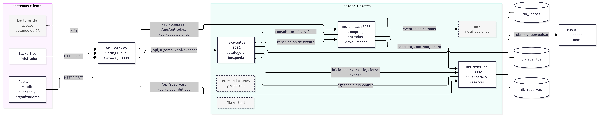

# TicketYa – Arquitectura (Entrega 2)

## 1. Microservicios y responsabilidades

| Servicio | Puerto | Base de datos | Responsabilidad | Req. |
|---|---|---|---|---|
| **api-gateway** | 8080 | – | Punto de entrada único. Enruta `/api/**` a cada servicio y **no expone** `/internal/**` | arquitectura |
| **ms-eventos** | 8081 | `db_eventos` | Catálogo: lugares, sectores, eventos, participantes, precios por sector, estados, búsqueda multicriterio. Dispara la inicialización del inventario al publicar y el cierre al cancelar | 1, 2, 3, 9 |
| **ms-reservas** | 8082 | `db_reservas` | Inventario de lugares (asientos y cupos), reservas temporales de 10 minutos, vencimiento, liberación, límite por cliente y **mecanismo anti doble venta** | 4 (reserva), 5 |
| **ms-ventas** | 8083 | `db_ventas` | Orquesta la compra: valida la reserva, cobra con la pasarela (mock), confirma, emite entradas con QR; idempotencia; devoluciones y reintegros por cancelación de evento | 4, 7 |
| **ms-notificaciones** (E2) | 8085 | `db_notificaciones` (MongoDB) | Recibe pedidos de notificación de los demás servicios, los guarda y los envía por email simulado con reintentos; deduplicación por clave; consulta para administradores | 11 |
| **ms-fila** (E2) | 8086 | Redis 7 | Fila virtual por evento: ingreso en orden de llegada, posición, habilitación por tandas con ventana de compra y consulta interna para ms-reservas | 6 |
| **ms-recomendaciones** (E2) | 8087 | `db_recomendaciones` (MongoDB) | Preferencias de cada cliente, registro de compras confirmadas que avisa ms-ventas, recomendaciones por puntaje y "también compraron" | 10 |

Cada servicio es un proyecto Spring Boot independiente (su propio `pom.xml`) que se construye y ejecuta por separado. Cada uno tiene su propia base: PostgreSQL para los servicios transaccionales, MongoDB para `ms-notificaciones` y `ms-recomendaciones`, y Redis para `ms-fila`. Todas se levantan con Docker y ningún servicio lee la base de otro. La pasarela de pagos es un componente mock dentro de ms-ventas (`PagoGateway` con implementación `MockPagoGateway`).

### API pública por servicio

Resumen de recursos. El detalle completo (parámetros, códigos de respuesta y ejemplos JSON) está en `openapi.yaml`.

| Servicio | Recursos públicos (vía gateway) |
|---|---|
| ms-eventos | `/lugares`, `/lugares/{id}/sectores`, `/eventos`, `/eventos/{id}`, `/eventos/{id}/precios`, `/eventos/{id}/publicar`, `/eventos/{id}/suspender`, `/eventos/{id}/reanudar`, `/eventos/{id}/cancelar`, `/eventos/{id}/sectores` |
| ms-reservas | `/eventos/{id}/disponibilidad`, `/eventos/{id}/sectores/{sid}/asientos`, `/reservas`, `/reservas/{id}` |
| ms-ventas | `/compras`, `/compras/{id}`, `/entradas`, `/entradas/{id}`, `/entradas/validar`, `/devoluciones`, `/devoluciones/{id}/aprobar`, `/devoluciones/{id}/rechazar` |
| ms-fila | `/fila/eventos/{id}/activar`, `/fila/eventos/{id}/desactivar`, `/fila/eventos/{id}/ingresar`, `/fila/eventos/{id}/posicion` |
| ms-recomendaciones | `/preferencias`, `/recomendaciones`, `/recomendaciones/eventos/{id}/tambien-compraron` |

### Rutas del API Gateway

El gateway quita el prefijo `/api` y reenvía cada ruta al servicio correspondiente. En las solicitudes autenticadas valida el JWT y obtiene de sus claims el identificador del usuario y su rol. Reemplaza los headers `X-User-Id` y `X-User-Rol` enviados por el cliente por los valores verificados del token. Las rutas públicas permiten el acceso sin token; si reciben uno válido, también propagan la identidad autenticada. El header `Idempotency-Key` se reenvía al servicio correspondiente.

| Ruta externa | Destino |
|---|---|
| `/api/auth/**` | ms-auth `:8084` |
| `/api/lugares/**`, `/api/eventos/**` | ms-eventos `:8081` |
| `/api/eventos/*/disponibilidad`, `/api/eventos/*/sectores/*/asientos`, `/api/reservas/**` | ms-reservas `:8082` |
| `/api/compras/**`, `/api/entradas/**`, `/api/devoluciones/**` | ms-ventas `:8083` |
| `/api/fila/**` | ms-fila `:8086` |
| `/api/preferencias/**`, `/api/recomendaciones/**` | ms-recomendaciones `:8087` |
| `/internal/**` | no se enruta (`404`) |

Las rutas de disponibilidad y asientos pertenecen a ms-reservas pero comparten el prefijo `/api/eventos/`. Por eso deben declararse **antes** que `/api/eventos/**` en la configuración del gateway, para que tengan prioridad.

**Por qué un API Gateway.** Es la única puerta de entrada, y concentra lo que de otro modo cada servicio tendría que repetir:

- **Validación del JWT en un solo lugar.** Los microservicios no conocen el secreto ni parsean tokens: confían en `X-User-Id` y `X-User-Rol`, que el gateway reemplaza siempre por los del token, así que un cliente no puede hacerse pasar por otro mandando esos headers.
- **Aislamiento de las rutas internas.** `/internal/**` no tiene ruta, así que solo se alcanza dentro de la red de los contenedores.
- **Un único origen para el frontend**, con CORS configurado una sola vez (`http://localhost:4200`).
- **Un punto común para la resiliencia** (timeouts y circuit breaker por servicio) y para el `X-Correlation-Id`.

El costo es un salto de red más y un componente que tiene que estar disponible. Se mitiga porque el gateway no guarda estado y se puede replicar detrás de un balanceador.

### Trazabilidad (E2)

El Gateway recibe el header `X-Correlation-Id` o genera uno nuevo si no fue enviado. Propaga el mismo identificador hacia el microservicio destino y lo devuelve en la respuesta. Además, registra cada solicitud HTTP con método, endpoint, usuario, código de respuesta, tiempo de procesamiento y `correlationId`. Estado en los microservicios:

- `ms-reservas`, `ms-ventas`, `ms-fila` y `ms-recomendaciones` conservan el identificador recibido o generan uno, lo propagan en sus llamadas salientes y lo escriben en cada línea de log. Además registran `HTTP_REQUEST` por solicitud.
- `ms-reservas`, `ms-ventas` y `ms-fila` registran además sus operaciones críticas (`OPERACION_CRITICA`).
- `ms-notificaciones` guarda el `correlationId` en cada notificación.
- `ms-eventos` y `ms-auth` todavía no lo manejan.

Los registros salen por la salida estándar de cada contenedor en formato `clave=valor`, listos para un recolector, pero no hay una herramienta de centralización desplegada. La secuencia completa está en `diagramas.md` (4.8).

### Resiliencia del API Gateway (E2)

El API Gateway incorpora mecanismos de tolerancia a fallos para evitar esperas prolongadas y controlar la indisponibilidad de los microservicios.

- **Timeouts HTTP:** limita el tiempo de conexión a 2000 ms y el tiempo de espera de respuesta a 5 segundos.
- **Circuit Breaker:** utiliza circuitos independientes para `ms-auth`, `ms-reservas`, `ms-eventos`, `ms-ventas`, `ms-fila` y `ms-recomendaciones`. Cada circuito evalúa una ventana de 10 llamadas, requiere al menos 5 para calcular la tasa de fallos y se abre cuando esta alcanza el 50%.
- **Recuperación:** permanece abierto durante 10 segundos y luego pasa a `HALF_OPEN`, donde permite hasta 3 llamadas de prueba para determinar si el servicio se recuperó.
- **Fallback:** cuando una ruta no puede completar la solicitud por la indisponibilidad del destino, devuelve HTTP 503 (`Service Unavailable`) con el código `SERVICIO_NO_DISPONIBLE` y un mensaje informativo.
- **Manejo global de errores:** el Gateway también cuenta con un manejador para errores de conexión, resolución de host y timeout que llegan al filtro global.

La configuración se encuentra en `api-gateway/src/main/resources/application.yml`. El fallback está implementado en `FallbackController` y el manejo global de errores en `GatewayErrorHandler`.

**Por qué un circuit breaker por servicio.** Sin él, si un microservicio está caído o colgado, cada solicitud espera hasta el timeout y ocupa recursos del gateway. Con una avalancha (por ejemplo, la apertura de una venta) esa espera se propaga a los demás servicios. Con el circuito abierto, el gateway responde `503` al instante y deja que el servicio se recupere. Que haya un circuito por servicio evita que la caída de `ms-ventas`, por ejemplo, corte también la consulta del catálogo.

Entre microservicios no hay circuit breaker. Cada llamada tiene timeouts propios y una política según su criticidad:

- Las que no pueden fallar en silencio (confirmar o liberar una reserva) propagan el error.
- Las auxiliares son best-effort o fail-open: el aviso a `ms-notificaciones` y a `ms-recomendaciones`, y la consulta a `ms-fila`.


## 2. Diagrama de módulos

Los componentes con línea punteada se implementan en la Entrega 2.



Dependencias síncronas entre servicios (todas REST):

| Origen | Destino | Para qué |
|---|---|---|
| ms-eventos | ms-reservas | Inicializar inventario al publicar; cerrar inventario al suspender o cancelar |
| ms-eventos | ms-ventas | Notificar la cancelación del evento para reintegrar entradas |
| ms-reservas | ms-eventos | Informar que el evento quedó agotado o volvió a tener lugares |
| ms-reservas (E2) | ms-fila | Antes de cada reserva, consultar si el cliente está habilitado en la fila virtual del evento. Timeout de 1 s; si falla, la reserva sigue (fail-open) |
| ms-ventas | ms-reservas | Consultar la reserva, confirmarla, liberarla, devolver lugares |
| ms-ventas | ms-eventos | Obtener precios, estado y fecha del evento al comprar |
| ms-ventas (E2) | ms-recomendaciones | Avisar cada compra confirmada (`POST /internal/compras`). Best-effort: timeouts de 500 ms y 1000 ms; si falla, la compra sigue igual |
| ms-recomendaciones (E2) | ms-eventos | Leer el catálogo publicado (`GET /eventos`), con copia en memoria de 30 s; si falla, usa la última copia o una lista vacía (`degradado: true`) |
| ms-ventas (E2) | ms-notificaciones | Pedir la notificación de compra confirmada y la de evento cancelado a cada comprador. Best-effort: una falla nunca afecta la compra ni la cancelación |
| ms-eventos (E2, pendiente) | ms-notificaciones | Evento modificado y artista favorito en la ciudad: todavía no implementado |

Las rutas `/internal/**` solo se invocan entre servicios; el gateway no las expone.

## 3. Mecanismo anti doble venta

La garantía vive en la **base de datos de ms-reservas**, no en memoria, por lo que funciona con varias instancias del servicio ejecutándose a la vez.

**Sectores numerados.** Al publicar el evento se generan las filas de `asiento` (una por lugar) en estado `LIBRE`, con `UNIQUE(evento_id, sector_id, fila, numero)`. Reservar es un `UPDATE` condicional dentro de una transacción:

```sql
UPDATE asiento
   SET estado = 'RESERVADO', reserva_id = :reservaId, version = version + 1
 WHERE evento_id = :e AND sector_id = :s AND estado = 'LIBRE'
   AND (fila, numero) IN (:lugares);
```

Si las filas afectadas son menos que los asientos pedidos, se hace rollback y se responde `409` (todo o nada). Como dos transacciones no pueden actualizar la misma fila a la vez, solo una gana. Además, `@Version` (bloqueo optimista de JPA) actúa como segunda barrera.

**Sectores no numerados.** Se descuenta el cupo de forma atómica:

```sql
UPDATE inventario_sector
   SET disponibles = disponibles - :n
 WHERE evento_id = :e AND sector_id = :s AND disponibles >= :n;
```

Si no afecta ninguna fila, no había cupo (`409`). Se agrega `CHECK (disponibles >= 0)` como red de seguridad.

**Transiciones de reserva mutuamente excluyentes.** Confirmar usa `WHERE estado = 'PENDIENTE' AND expira_en > now()` y vencer usa `WHERE estado = 'PENDIENTE' AND expira_en <= now()`. Una reserva no puede estar confirmada y vencida a la vez.

**Idempotencia del pago.** `compra` tiene `UNIQUE(cliente_id, idempotency_key)` y guarda un hash del request. Un reintento con la misma clave devuelve la respuesta original sin volver a cobrar. `confirmar` y `liberar` son idempotentes.

**Con varias instancias de ms-reservas.** Ninguna de las garantías depende de memoria compartida ni de locks en la JVM:

- **Límite por cliente.** Lo serializa un *advisory lock* de PostgreSQL por cliente y evento, dentro de la transacción de la reserva. Dos pedidos simultáneos del mismo cliente, aunque lleguen a instancias distintas, se cuentan de a uno.
- **Inventario cerrado.** El inventario se lee con `FOR SHARE`, así que un cierre concurrente (suspensión o cancelación) espera a que terminen las reservas en curso.
- **Vencimiento.** El job de vencimiento toma las reservas con `FOR UPDATE SKIP LOCKED`, de modo que varias instancias se reparten el trabajo sin vencer dos veces la misma reserva.
- **Hora.** Las fechas salen siempre de la base (`localtimestamp`), no del reloj de cada instancia.

La fila virtual y la caché del catálogo no participan de esta decisión: la fila solo decide quién puede intentar reservar, y la caché no guarda disponibilidad.

**Prueba.** Un test lanza N hilos (por ejemplo 50) con un `CountDownLatch` que reservan el mismo asiento, y otro que compite por el último cupo de una zona; verifica exactamente un éxito y N-1 respuestas `409`. Se ejecuta contra una base real (Testcontainers o la de Docker), porque H2 no refleja bien el comportamiento de bloqueos.

## 4. Consistencia en la compra (saga orquestada por ms-ventas)

No existe una transacción que abarque los tres servicios, así que ms-ventas coordina los pasos y deshace los ya hechos si uno falla.

| Paso | Acción | Si falla, compensación |
|---|---|---|
| 1 | Registrar compra `PENDIENTE` (clave de idempotencia) | Ninguna |
| 2 | Verificar la reserva en ms-reservas (vigente, del cliente) | Compra `FALLIDA`, `410` o `403`; no se cobra |
| 3 | Cobrar en la pasarela con una clave derivada del id de la compra | Rechazo: liberar reserva y compra `RECHAZADA` (`402`). Sin respuesta: compra `PENDIENTE` (`504`), se reintenta con la misma clave |
| 4 | Confirmar reserva en ms-reservas | Si venció: reembolsar el pago, compra `FALLIDA` (`410`) |
| 5 | Emitir entradas con QR y compra `APROBADA` | Si falla la base: reintentar con la misma clave; si no se puede, reembolsar y liberar |

**Cobro con resultado incierto.** Si la pasarela no responde después de recibir el cobro, no se sabe si cobró. Para que reintentar sea seguro, ms-ventas envía siempre la misma clave de cobro, derivada del id de la compra, y la pasarela devuelve el resultado original si recibe dos veces la misma clave. Por eso la compra queda `PENDIENTE` (no `FALLIDA`): el reintento con la misma `Idempotency-Key` reutiliza la misma compra y la misma clave, y el cliente no paga dos veces.

**Resiliencia de pagos (E2).** En la Entrega 1 quedaba un hueco: si tras un timeout el cliente no reintentaba y la pasarela había cobrado, el cobro quedaba sin entradas. La Entrega 2 lo resuelve (spec `resiliencia-pagos`):

- **Consulta antes de reintentar.** Ante un timeout, ms-ventas consulta el estado del cobro a la pasarela con la misma clave de idempotencia, hasta `ticketya.pagos.max-reintentos` (2) veces. Solo reintenta el cobro si la pasarela confirma que no lo registró, así que nunca hay un segundo débito.
- **Estado `PAGO_INCIERTO`.** Si la incertidumbre sigue, la compra queda en `PAGO_INCIERTO`, la reserva **no** se libera y la respuesta es `504 PASARELA_TIMEOUT`.
- **Reconciliación.** `ReconciliacionPagosJob` corre cada 30 s y resuelve cada compra en `PAGO_INCIERTO`. Si el pago resultó aprobado, confirma la reserva y emite las entradas, o reembolsa y marca `FALLIDA` si la reserva venció. Si fue rechazado o no se concretó, libera la reserva. Si sigue incierto, la deja como está. Una compra que falla no frena a las demás.

Los estados `COBRADO` y `REEMBOLSO_PENDIENTE` que se habían previsto no se implementaron: el reembolso se hace en el mismo paso de la compensación.

**Consistencia.** No hay transacciones distribuidas. Cada servicio es consistente dentro de su base, y entre servicios la consistencia es eventual, sostenida por la saga:

- **Pasos idempotentes.** `confirmar` y `liberar` se pueden repetir sin efecto doble, y el cobro usa una clave derivada de la compra.
- **Estados intermedios explícitos.** `PENDIENTE` y `PAGO_INCIERTO` hacen que un corte en cualquier punto deje un estado recuperable.
- **Vencimiento de la reserva.** La reserva temporal de 10 minutos acota cuánto tiempo puede quedar un lugar tomado por una compra que no termina.

El detalle gráfico está en `secuencia-compra.md`.

## 5. Estados


## 6. Decisiones de diseño

1. **Estado `SUSPENDIDO`.** El enunciado lista cinco estados pero pide que el administrador pueda "suspender"; se agrega `SUSPENDIDO` como estado reversible. Equivale a devolver el evento a `BORRADOR` si se prefiere no sumar un estado.
2. **Autenticación y autorización mediante JWT (E2).** El API Gateway valida la firma y vigencia del JWT en las rutas protegidas. Obtiene el identificador del usuario del subject y el rol del claim `rol`, y propaga esos datos mediante `X-User-Id` y `X-User-Rol`, reemplazando cualquier valor enviado por el cliente. Las rutas públicas permiten solicitudes sin token y aceptan tokens válidos para identificar al usuario cuando corresponde. Cada microservicio aplica las restricciones de acceso según los roles `CLIENTE`, `ORGANIZADOR`, `ADMIN` y `PERSONAL_ACCESO`.
3. **Límite por cliente en ms-reservas.** Se controla ahí porque conoce reservas activas y lugares vendidos por cliente y evento. El valor (`maxPorCliente`, por defecto 4) se define en el evento y se copia al inventario al publicar.
4. **Asientos pre-generados al publicar.** Simplifica la reserva atómica (`UPDATE` condicional) a costa de insertar una fila por asiento al publicar; para un estadio de 50.000 lugares se hace en lotes.
5. **Pasarela mock.** Decide por el token de pago: `tok_ok` aprueba, `tok_rechazado` rechaza, `tok_timeout` simula que la pasarela cobró pero no respondió a tiempo. La pasarela mock recibe una clave de cobro y, si la repite, devuelve el resultado original sin cobrar de nuevo. Los reintegros también son simulados.
6. **Precios y fecha.** ms-ventas los obtiene de ms-eventos al comprar y los guarda como snapshot en la compra y en la entrada (necesita la fecha para la regla de 72 horas).
7. **Código QR.** `codigoQr` es un UUID aleatorio, único por entrada; la imagen PNG puede generarse con ZXing en la capa de presentación.
8. **Relevancia en la búsqueda.** Versión simplificada: coincidencia de `q` en nombre, descripción y participantes, y luego cercanía de la fecha.
9. **Notificaciones en MongoDB (E2).** Cada notificación es un documento con tipo, destinatario, `datos` libres, estado (`PENDIENTE`, `ENVIADA`, `FALLIDA`), intentos, último error, fechas y `correlationId`. Se eligió MongoDB porque la forma de `datos` cambia según el tipo (una compra lleva sus entradas y un cambio de evento lleva el valor anterior y el nuevo), la escritura es intensa (una cancelación genera un pedido por comprador), no hay joins y las consultas son por usuario y estado, cubiertas con índices compuestos.
10. **Envío asíncrono con reintentos (E2).** `POST /internal/notificaciones` guarda la notificación y responde `202` sin esperar al envío, así que una falla al notificar nunca afecta la operación del que llama (por ejemplo, la compra). Un procesador periódico toma cada notificación vencida de forma atómica (`findAndModify`) y la envía. Si falla, programa el siguiente intento con espera exponencial (2 s, 4 s) hasta 3 intentos y después la deja `FALLIDA`. Como la espera se guarda en el documento, un reinicio no pierde los pendientes. La deduplicación la garantiza un índice único parcial sobre `claveDeduplicacion`, también con pedidos simultáneos.

## 7. Stack técnico (E1)

Java 21 y Spring Boot 3 (web, data-jpa, validation), Spring Cloud Gateway, springdoc-openapi, PostgreSQL (o MySQL) en Docker con un schema por servicio, Flyway o `ddl-auto` para el esquema, JUnit 5 y Mockito para pruebas unitarias, Testcontainers para la prueba de concurrencia, Postman para la colección de requests.

## 8. Fila virtual (E2)

Funcionalidad 6, en una versión simplificada. En eventos de alta demanda, un `ADMIN` u `ORGANIZADOR` activa la fila del evento con un tamaño de tanda y los segundos entre tandas. Los clientes ingresan y consultan su posición. Cada `segundosEntreTandas`, los primeros `tamanoTanda` clientes en espera quedan habilitados durante una ventana de compra de 10 minutos; si no reservan en ese tiempo, pierden el turno. El detalle completo está en `openspec/changes/archive/2026-11-23-add-fila-virtual/design.md`.

**Por qué Redis.** La fila es un estado efímero, con mucha escritura justo en la apertura de la venta:

- **Atomicidad.** Redis ejecuta los scripts Lua de a uno. Cada operación que lee y escribe (ingresar, habilitar una tanda, vencer turnos) es un script atómico frente a todas las instancias de ms-fila, sin locks distribuidos.
- **Estructuras ordenadas.** Un *sorted set* por evento guarda a los clientes en espera con su número de llegada (`INCR`). `ZRANK` da la posición y `ZPOPMIN` saca la tanda en orden. Otro *sorted set* guarda a los habilitados con el fin de su ventana como puntaje.
- **TTL.** Las claves de cada fila vencen solas a las 24 horas sin actividad, así que una fila abandonada no queda para siempre.
- **Rendimiento.** Trabaja en memoria, así que la consulta que hace ms-reservas en cada reserva no carga a PostgreSQL en el pico.

**Tandas con varias instancias.** El proceso periódico (cada 1 s) corre en todas las instancias. El script de la tanda verifica dentro de Redis si ya llegó `proximaTandaEn`. La primera instancia que lo ejecuta saca la tanda con `ZPOPMIN` y corre `proximaTandaEn` hacia adelante; las demás no hacen nada. Así nadie queda habilitado dos veces y no se adelanta ninguna tanda. Cada habilitación y cada vencimiento se registran una sola vez (`CLIENTE_HABILITADO`, `TURNO_VENCIDO`), porque solo los registra la instancia cuyo script los devolvió.

**Integración con ms-reservas (fail-open).** Antes de abrir la transacción de una reserva, ms-reservas consulta `GET /internal/fila/eventos/{e}/clientes/{c}/estado` con un timeout de 1 s y propaga el `X-Correlation-Id`. Si la fila está activa y el cliente no está habilitado, responde `403 FILA_NO_HABILITADO`. Si ms-fila no responde o falla, la reserva sigue y se registra la advertencia `FILA_NO_DISPONIBLE`:

- La fila ordena el acceso, pero no es una garantía de integridad. La anti doble venta y el límite por cliente siguen en la base de ms-reservas.
- Con fail-closed, una caída de ms-fila o de Redis frenaría todas las ventas, incluidas las de eventos sin fila.
- El costo de una caída es que, mientras dura, se puede reservar sin respetar el orden.

**Simplificaciones frente a un sistema real:**

- Se consulta a ms-fila en cada reserva, en lugar de emitir un token de turno firmado.
- El turno dura toda la ventana y no se consume al comprar.
- Las tandas son de tamaño fijo, no se adaptan a la capacidad del checkout.
- No hay protección anti-bots.
- El cliente consulta su posición periódicamente, en lugar de recibir avisos por WebSocket.
- Redis corre en un solo nodo con AOF.
- La fila se activa manualmente y no se valida que el organizador sea el dueño del evento.
- El control se hace solo al reservar, no al pagar. Alcanza porque para comprar hace falta una reserva.

## 9. Preferencias y recomendaciones (E2)

Funcionalidad 10 (US-24 y US-25), sin machine learning. Cada cliente guarda sus tipos de evento, artistas favoritos y ciudad. `ms-recomendaciones` le sugiere eventos `PUBLICADO` que todavía no compró, ordenados por un puntaje explicable, y responde "quienes compraron X también compraron Y". El detalle está en `openspec/changes/add-preferencias-recomendaciones/design.md`.

**Por qué MongoDB.** Se reutiliza el contenedor `mongo`, con la base propia `db_recomendaciones`:

- Las preferencias son un documento por cliente (`_id` = clienteId) con dos listas y un campo opcional. Sumar otro criterio no requiere migrar un esquema.
- Cada compra es un documento con `eventoIds` como arreglo, y un índice multikey responde "quiénes compraron el evento X" sin tablas intermedias.
- No hay joins. Los conteos de popularidad y de compradores en común se hacen con el *aggregation pipeline* (`$match`, `$unwind`, `$group`) dentro de la base.

**Puntaje.** Es una función pura, probada con pruebas unitarias:

| Componente | Puntos | Motivo |
|---|---|---|
| tipo en las preferencias | 3 | `TIPO` |
| algún participante es un artista favorito | 3 | `ARTISTA` |
| ciudad igual a la de las preferencias | 2 | `CIUDAD` |
| compradores en común / máximo entre los candidatos | hasta 2 | `TAMBIEN_COMPRARON` |
| compradores / máximo entre los candidatos | hasta 1 | `POPULAR` |

Una preferencia explícita siempre pesa más que la popularidad. Si el cliente no tiene preferencias ni compras, gana la popularidad; si nadie compró nada, el desempate por fecha devuelve los próximos eventos.

**Alimentación desde ms-ventas.** `CompraService.notificarCompraConfirmada` es el punto común de los tres caminos que confirman una compra (directa, reintento y reconciliación). Ahí, además de notificar, se avisa a `ms-recomendaciones` con `POST /internal/compras`:

- Copia el enfoque de `NotificacionesClient`: timeouts cortos, nunca lanza y deja la advertencia `RECOMENDACIONES_NO_DISPONIBLE` con el `correlationId` si falla.
- El registro es idempotente por `compraId`, que es el `_id` del documento.

**Catálogo con fallback.** La lista de eventos viene de `GET /eventos` de ms-eventos, paginada de a 100 y con una copia en memoria de 30 segundos. Si ms-eventos no responde, se usa la última copia aunque haya vencido, o una lista vacía. La respuesta es siempre `200`, con `degradado: true`; nunca `500`.

**Simplificaciones:**

- Puntaje lineal con pesos fijos en lugar de modelos de machine learning.
- Aviso HTTP best-effort en lugar de un broker de mensajes.
- Solo cuentan las compras confirmadas desde el despliegue, sin importar el historial anterior.
- Las devoluciones no restan compras.
- La popularidad no decae con el tiempo.
- El catálogo completo se guarda en memoria, con un tope de 2000 eventos.

## 10. Caché del catálogo de eventos (E2)

`ms-eventos` cachea en memoria, con Caffeine, las dos lecturas públicas más frecuentes (spec `catalogo-cache`):

| Caché | Qué guarda | Clave |
|---|---|---|
| `catalogoEventos` | resultado de `GET /eventos` (búsqueda) | todos los filtros, el orden, la dirección y la paginación |
| `detalleEvento` | resultado de `GET /eventos/{id}` | `eventoId`; no se guarda si el evento está en `BORRADOR` |

- **TTL:** 5 minutos (`ticketya.cache.ttl-minutes`, variable `CACHE_TTL_MINUTES`), con un máximo de 1000 entradas por caché. Las respuestas no dependen de quién consulta.
- **Invalidación:** publicar, suspender, reanudar, cancelar, un cambio efectivo de disponibilidad (agotado o con lugares) y el job que finaliza eventos borran el catálogo completo y el detalle del evento. El borrado se hace después del commit (`TransactionAwareCacheManagerProxy`): si la transacción se revierte no se borra nada, y lo que una lectura guardó mientras la transacción estaba en curso se borra al confirmarla. Editar un borrador no invalida nada, porque no es público.
- **Qué NO se cachea:** la disponibilidad de asientos y cupos, el inventario de reservas, los sectores con sus capacidades y los mapas y estados de cada asiento. Todo eso cambia con cada reserva y vive en `ms-reservas`, donde se resuelve la anti doble venta: cachearlo mostraría lugares libres que ya no lo están. Por eso la caché nunca participa de la decisión de vender.
- **Con varias instancias:** la caché es local a cada instancia de `ms-eventos`. Una invalidación borra solo la caché de la instancia que procesó el cambio, y las demás pueden mostrar el dato anterior hasta que venza el TTL (5 minutos como máximo). Se acepta porque son datos de catálogo, no de stock. Una caché distribuida (por ejemplo, Redis) lo resolvería.
